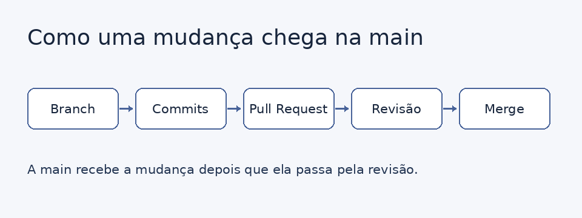

# Diário de bordo

Fiz esse diário para guardar o que estou aprendendo sobre Git e GitHub. Assim eu consigo voltar nas anotações quando for fazer um trabalho em grupo ou quando esquecer alguma etapa.

## Aulas

- [Aula 1 — Por que usar Git?](aulas/aula-01.md)
- [Aula 2 — Trabalho em equipe](aulas/aula-02.md)

